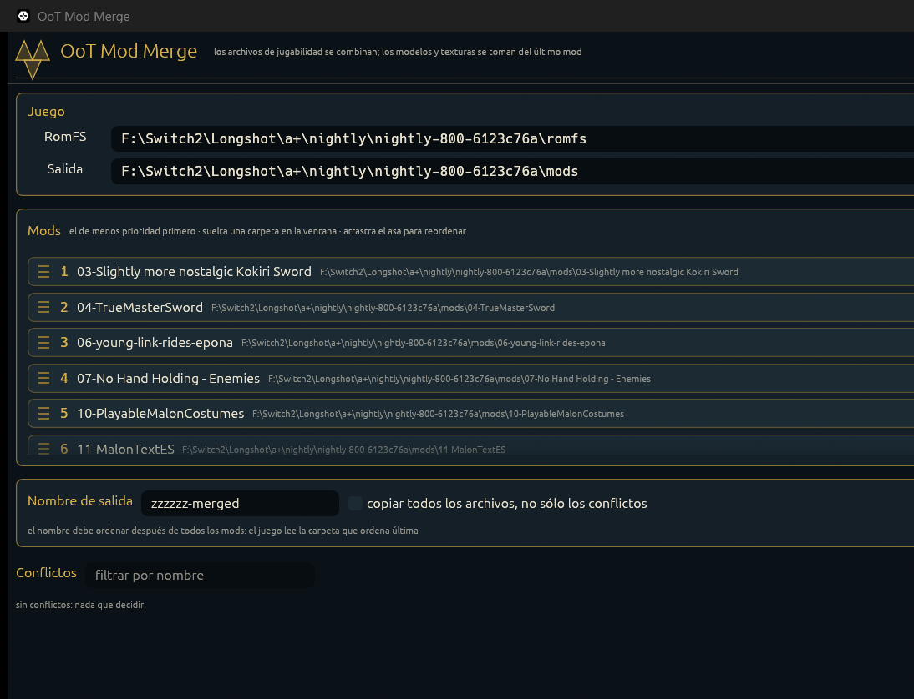

# Using OoT Mod Merge

OoT Mod Merge joins the files that two or more mods of the Ocarina of Time remake both change, so the
mods work together instead of one overwriting the other. This guide covers the window; the command line
is at the end.



> It is an alpha. It has been tried with Hyrule Survivors, Super Hero Boost (OcarinaTweaks), Playable Malon
> and others with good results, but it is **not guaranteed** to work with every mod. Keep your original mod
> folders and test in the game.

## What you need

- The mods you want to join, each as a folder with a `romfs/` folder inside.
- The game's own **RomFS** folder (the one from your dump or from the recompiled game). The program reads
  the game's compression dictionaries and its own copy of each file from there; it never changes it.
- A folder to write the result to.

## Step by step

1. **Open** `oot-mod-merge.exe`. The language (Spanish or English) follows the system and can be switched
   in the window.
2. **Fill in the game.** Either:
   - drag the whole game folder (the one that has `romfs/` and `mods/` beside each other) onto the window:
     it fills the RomFS and the output field; or
   - use **Browse...** on the **RomFS** field and on **Output**, or drop a folder on each.
3. **Add the mods.** Drop their folders on the window or press **Add...**. Each one must have `romfs/` inside.
   You need at least two.
4. **Set the priority.** The list goes **lowest priority first**: drag the handle (or use Up / Down) so the
   mod whose changes should win is **last**. This only matters where two mods set the *same* value
   differently; everything else is combined.
5. **Name the output.** The default is `zzzz-merged`. The name has to **sort after every mod**: the game
   reads the folder that sorts last, and that is how the merged files win.
6. Press **Scan conflicts**. Nothing is written. The table lists every file more than one mod ships:
   - *merged*: the program can combine it, and the detail says what each mod adds;
   - *conflict* ("cannot be merged"): event flows, logic, textures, models, fonts and sounds. The last mod's
     copy is used. Use the **winner** column to pick another mod for a file, and the filter box to find it.
7. Press **Merge**. The result is written to `<output>/<name>/romfs`, plus `MERGE-REPORT.md` next to it.

## Installing the result

By default the output holds **only the files that were in conflict**. It is an overlay: leave the original mod
folders where they are and put the merged folder next to them.

- **Recompiled game** (Longshot, Hookshot, ReLink): put it in `<game>/mods/`, for example
  `<game>/mods/zzzz-merged`. The recompiled game needs to be **rebuilt** after a mod folder changes.
- **Emulator:** put it in the emulator's load folder for the game, beside the other mods.

If you would rather have one self-contained folder, tick **copy every file, not only the conflicts** before
merging.

## Reading the report

`MERGE-REPORT.md` lists every file: what was merged (with what each mod gave and how many rows it retunes),
what was kept from one mod and why. Read the "not merged" part: those are the files where one mod's version
replaces the other's, so a mod that depends on them may lose a feature.

## If something goes wrong

- *"Add at least two mods"* / *"None of the folders listed is a mod"*: each mod folder needs a `romfs/` inside.
- *"Set the game's RomFS folder"*: point it at the game's own `romfs`, which holds `Pack/ZsDic.pack.zs`.
- The game crashes or a feature of a mod is missing: remove the merged folder to get back to the original
  behaviour, then merge a smaller set of mods to find the one that conflicts. Pick another winner in the
  **winner** column and merge again.
- The window remembers what you entered in `%APPDATA%\OOT-ModMerge\config.txt`, a plain `key=value` file.

## Command line

```
oot-mod-merge.exe merge --romfs <game>/romfs --out <folder> [--name zzzz-merged] [--all] [--dry-run]
                        [--win <file>=<mod>]... <mod>...
oot-mod-merge.exe check --romfs <game>/romfs <file.zs>
```

Mods are listed lowest priority first. `--dry-run` only reports, `--all` copies every file, and
`--win <file>=<mod>` forces one file to a given mod.
